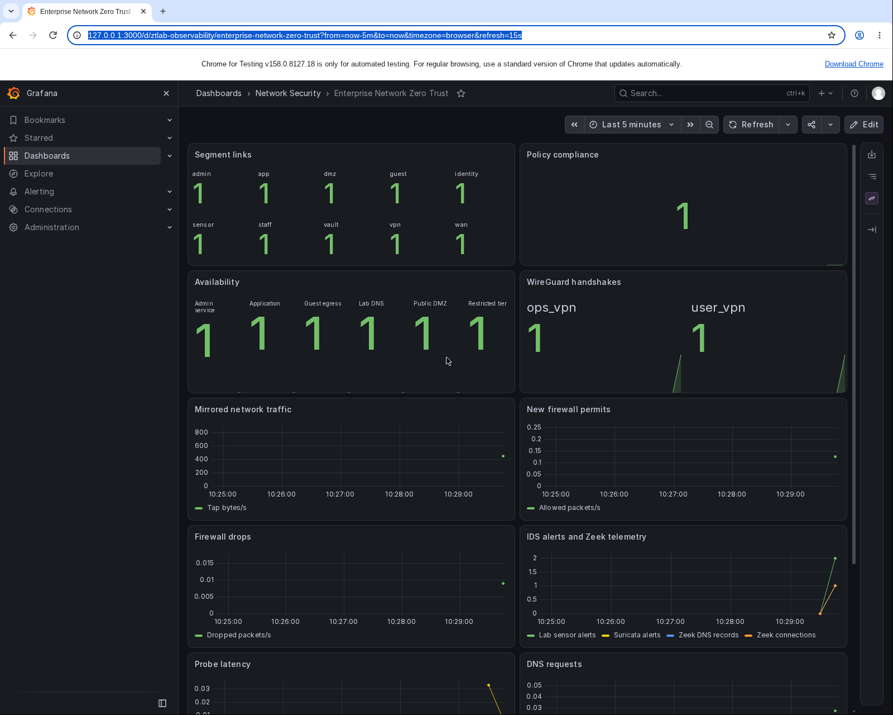
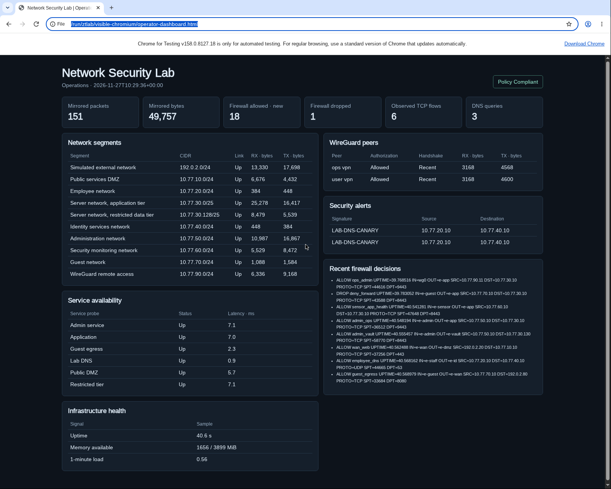

# Enterprise Network Zero Trust Lab

**A reproducible enterprise security lab built around a detached QEMU/KVM guest.** Follow a request from the simulated WAN through a stateful firewall, then see how network policy, client certificates, and service roles govern access.

[Architecture](docs/architecture.md) · [Quick start](#run-the-lab) · [Security assessment](docs/assessment.md) · [Evidence index](evidence/README.md)

[](evidence/add-ons/grafana.png)

*Live Grafana dashboard captured in Chromium inside the lab. Click the image for full resolution.*

| Portfolio readiness | Baseline checks | Policy paths | Integration checks |
| :---: | :---: | :---: | :---: |
| **100/100** | **68 passed** | **49 verified** | **5 passed** |

The score applies to the laboratory rubric. The assessment records the evidence and the limits of the test environment. [Assessment](docs/assessment.md) · [Baseline results](evidence/results.md) · [Integration results](evidence/add-ons/results.md)

## What the lab demonstrates

| Area | Verified behavior |
| --- | --- |
| **Segmentation** | Ten isolated segments, two server tiers, stateful nftables filtering, NAT, and default-deny forwarding. |
| **Zero Trust** | Private HTTPS requires mTLS and service-specific authorization. Two WireGuard peers have distinct permissions. Revocation and fresh enrollment were tested. |
| **Detection and prevention** | Suricata detected the mirrored DNS canary and blocked it in a scoped inline exercise. Zeek correlated the DNS request with its connection record. |
| **Observability** | Prometheus scraped via mTLS and fired the canary alert. Grafana returned live data for all 11 panels. |
| **Automation and recovery** | Python and Ansible provision and validate the lab. Tests cover firewall rollback, configuration drift, service recovery, and an idempotent Ansible repeat. |

The guest boots without a host-facing NIC. The WAN simulator, traffic probes, and packet capture all run inside the guest. [Network diagram and addressing](docs/architecture.md) · [Communication matrix](docs/communication-matrix.md) · [Threat model](docs/threat-model.md)

## Operator dashboard

[](evidence/add-ons/dashboard-visible.png)

*Chromium rendering of a freshly authenticated operator dashboard response. Click the image for full resolution.*

## Run the lab

The base profile runs on Fedora x86-64 with local QEMU and a matching installed kernel. It allocates **2 vCPUs and 640 MiB RAM**. [Prerequisites and recovery](docs/operations.md)

```sh
python3 labctl.py plan
python3 labctl.py verify
python3 labctl.py report
```

Use `python3 labctl.py live` to open the guest console. The targeted workflow separately verifies Suricata, Zeek, Prometheus, Grafana, Ansible, and headed Chromium using verified local packages. [Targeted commands](docs/operations.md#targeted-extension-verification) · [Dependency provenance](evidence/dependency-provenance.json)

## Review the work

- **Policy** · [Source model](config/lab.json) · [Generated nftables rules](config/edge.nft) · [Identity and VPN design](docs/policies.md)
- **Automation** · [Python controller](labctl.py) · [Ansible playbook](automation/site.yml) · [Deployment and recovery](docs/operations.md)
- **Evidence** · [Run manifest](evidence/manifest.json) · [Integration manifest](evidence/add-ons/manifest.json) · [Synthetic DNS capture](evidence/synthetic-dns.pcap)
- **Handoff** · [Repository handoff](HANDOFF.md) · [Optional integrations](docs/integrations.md) · [MIT License](LICENSE)
