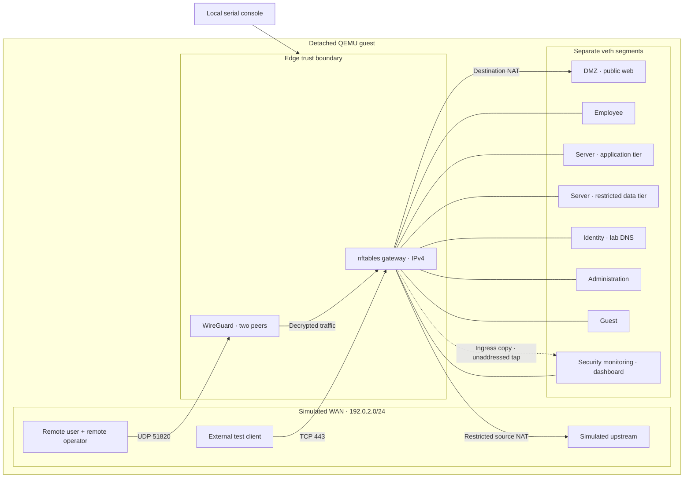
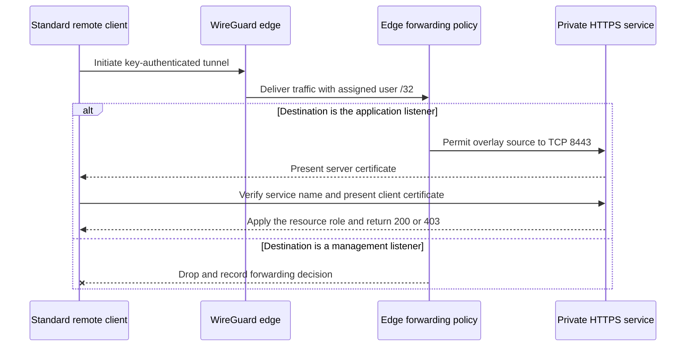

# Architecture and addressing

## Network topology

There are no host-side lab routes or bridges. The guest contains a private, unaddressed WAN bridge and a distinct pair of Ethernet interfaces for each wired LAN. Two disjoint route prefixes separate the application and restricted tiers. Both tiers cross the firewall to reach each other.

| Segment | CIDR | Edge gateway | Fixtures |
| --- | --- | --- | --- |
| Simulated WAN | `192.0.2.0/24` | `192.0.2.1` | `.20` external client, `.80` upstream, `.30` remote user transport, `.31` remote operator transport |
| DMZ | `10.77.10.0/24` | `10.77.10.1` | `10.77.10.10` HTTPS web |
| Employee | `10.77.20.0/24` | `10.77.20.1` | `10.77.20.10` employee |
| Server application tier | `10.77.30.0/25` | `10.77.30.1` | `10.77.30.10` app and management HTTPS on separate ports |
| Server restricted tier | `10.77.30.128/25` | `10.77.30.129` | `10.77.30.130` restricted service |
| Identity services | `10.77.40.0/24` | `10.77.40.1` | `10.77.40.10` lab DNS |
| Administration | `10.77.50.0/24` | `10.77.50.1` | `10.77.50.10` operator client |
| Security monitoring | `10.77.60.0/24` | `10.77.60.1` | `10.77.60.10` mTLS dashboard and `mon0` tap without an IP address |
| Guest | `10.77.70.0/24` | `10.77.70.1` | `10.77.70.10` guest client |
| Remote access | `10.77.90.0/24` | `10.77.90.1` | `10.77.90.10` user, `10.77.90.11` operator |

## Routing and data flows

1. Each wired fixture has one gateway on its segment. The edge has connected IPv4 routes and no default route. The guest root namespace has only the unaddressed WAN bridge and no default route.
2. The external fixture reaches the public status service through destination NAT to the DMZ. Direct WAN-to-DMZ access, DMZ-to-private traffic and DMZ upstream egress fall through to default deny.
3. Guest and Employee can reach lab DNS and one upstream host and port. The upstream sees the edge address through source NAT. The upstream fixture is on the simulated WAN.
4. WireGuard terminates at the edge. It maps each peer key to one tunnel address. The forwarding chain applies independent rules to the user and operator overlay addresses.
5. An operator from Admin or the privileged overlay can reach the management HTTPS listener, restricted tier and dashboard. These services separately check the operator client certificate. The guest serial console is the infrastructure administration path.
6. Routed Ethernet ingress is copied to the monitoring tap before the forwarding decision. An unaddressed mirror interface receives copies for observation. The dashboard uses the monitoring network's separate addressed interface. WireGuard state and firewall decisions provide VPN visibility alongside the tap.

See the [communication matrix](communication-matrix.md) for source, destination, protocol, port and identity constraints.

## Remote access decision sequence

## Technology selection

| Technology | Decision |
| --- | --- |
| QEMU with TCG | Boot a local Fedora kernel in one detached guest. This execution environment could run QEMU without access to libvirt, host netlink or a usable `/dev/kvm` device. |
| KVM and libvirt | The launcher can select KVM when `/dev/kvm` is writable. Libvirt inventory and management require their own socket permissions. The reproduced evidence used direct QEMU. |
| GNS3 and Podman | Both were detected locally. This topology needs kernel routing and firewall behavior, which one guest provides with fewer dependencies and without invoking host virtual switches or container networking. |
| nftables | Linux supplies stateful filtering, NAT, per-rule kernel counters and atomic transactions. Text input and JSON output support review, backup and drift detection. |
| Direct mTLS and WireGuard | Independent client, service and peer identities can be exercised against live traffic with the installed binaries. |
| DNS and monitoring | dnsmasq serves the lab zone. The passive sensor, tcpdump, kernel logs and authenticated dashboard provide evidence from the local toolset. |
